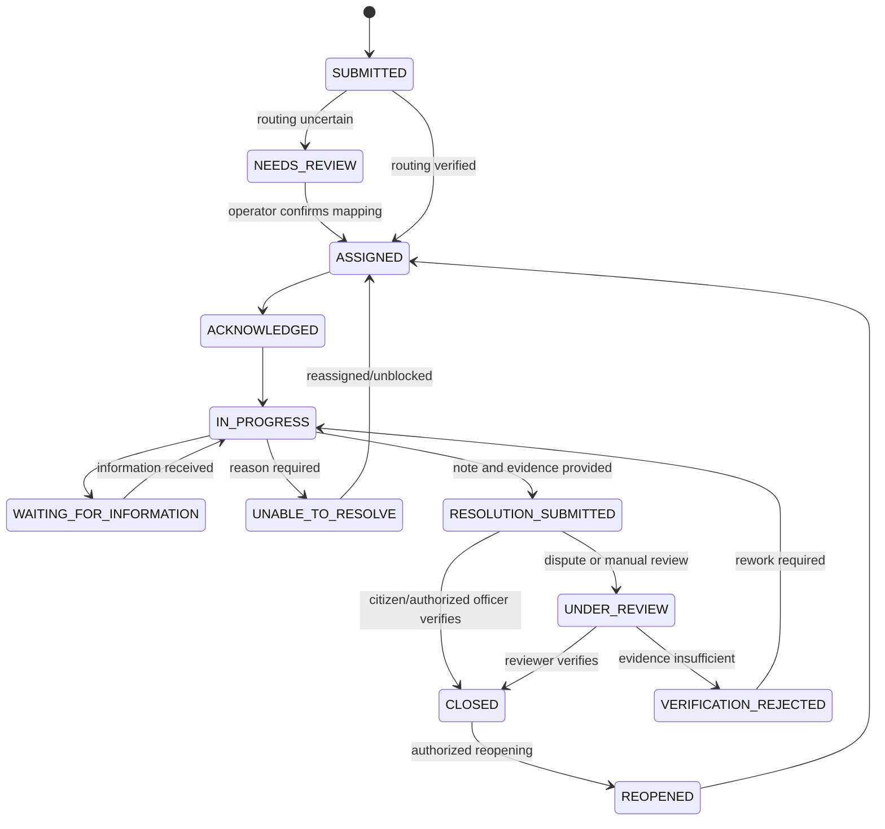

# MCL Smart Municipal Complaint Management System

**Document type:** Product, workflow, architecture, and implementation plan  
**Organization:** Municipal Corporation Ludhiana (MCL)  
**Status:** Proposed implementation baseline; operational policies and reference data must be validated with MCL before production  
**Plan basis:** New requirements captured for this system. This plan is standalone and does not inherit the old BB implementation plan or its existing architecture.

---

## 1. Product vision

Build a shared municipal complaint-management system that allows citizens to report civic issues and enables MCL operators, Junior Engineers (JEs), and supervisory officers to assign, track, resolve, verify, and analyze complaints through one auditable workflow.

The system should make the operational state of every complaint clear: who owns it, what has happened, what action is due next, whether it is overdue, what evidence supports a claimed resolution, and who made each change.

### Confirmed decisions

- Existing complaint records will be **imported** into the new system.
- Complaints are automatically assigned when location and responsibility mappings are sufficiently reliable. Uncertain cases go to an operator review queue.
- The initial service target is **48 working hours**. Working calendars, holidays, pause rules, and the event that starts the clock must be configurable and confirmed before the pilot.
- A JE may submit a complaint as resolved, but it is not silently closed. Closure requires citizen verification or verification by an authorized MCL officer. A citizen who reports that the issue remains unresolved sends the complaint back for review/rework.
- Operators have restricted permissions. Original submissions and history must not be silently overwritten or deleted.
- Citizens use registered accounts. Staff members use individual accounts; shared staff credentials are not permitted.
- The officer hierarchy is initially **JE → SDO → XEN → SE → ZC → JC**. Keep it configurable because the sequence may change later.
- The initial complaint catalogue uses the 15 supplied complaint types and their supplied branch/joint mappings. Categories remain configurable.
- Shift accountability is handled through individual action history, timestamps, ownership, and explicit handover records—not by sharing an operator account.
- Capture the resolver's location alongside resolution evidence when the device supports it and permission is granted. Record accuracy and capture limitations; do not claim GPS proves where a photo was taken.
- Citizens can maintain saved addresses and choose a saved address or a new map pin for each complaint.
- **Initial notification channels:** in-app and push. SMS is deferred until the core system works reliably. Priority-based handling and MLA/referral-specific rules are also deferred.
- AI suggestions, duplicate detection, and hotspot analytics are later-stage features. AI must not make unreviewed assignment or closure decisions.

### Product principles

1. **One source of truth:** all interfaces operate on the same complaint records and status history.
2. **No silent changes:** consequential actions have an actor, timestamp, and audit event.
3. **Human review for uncertainty:** incorrect location or JE mapping must not be hidden behind automatic guesses.
4. **Resolution is not closure:** submitting resolution evidence and verifying the outcome are separate steps.
5. **Configurable policy:** working hours, hierarchy, categories, deadlines, and permissions should not be hardcoded into UI components.
6. **Mobile-friendly fieldwork:** JE workflows must work on phones, including when location is unavailable or connectivity is weak.
7. **Privacy by default:** citizen information and uploaded media are not publicly accessible by default.

---

## 2. Scope and boundaries

### Initial release (MVP)

- Citizen account registration/login and profile/address management.
- Complaint registration with description, category, photo/video, and map pin.
- Unique public complaint number and private internal ID.
- Automatic department/JE assignment where verified mappings support it; otherwise operator review.
- JE complaint list, details, acknowledgement, progress updates, resolution note, and evidence submission.
- Operator complaint register, review queue, follow-up, reassignment/routing correction within permissions, and shift handover.
- Citizen complaint tracking and manual verification of claimed resolution.
- Configurable 48-working-hour deadline calculation, reminders, overdue flags, and hierarchy-based escalation.
- In-app and push notifications with delivery tracking and safe retries.
- Dashboard with current backlog, status, aging, officer/department/zone/ward summaries where data is reliable.
- Existing complaint import with reconciliation and import reporting.
- Role-based authorization, audit history, private evidence storage, backups, and basic operational monitoring.

### Deferred until the core is validated

- SMS notification delivery (design the notification service so SMS can be added later).
- Priority-based routing, urgency tiers, and MLA/referral-specific treatment.
- AI image classification, AI-generated summaries, and AI-assisted categorization.
- Predictive analytics and advanced hotspot forecasting.
- Complex offline synchronization, unless the pilot establishes a concrete field requirement.
- Integrations with unrelated municipal systems, sensors, vehicle tracking, or broader ICCC operations.

### Not a goal

This project is not a copy of the existing ICCC Command Wall. Its UI may take inspiration from useful monitoring patterns, but the product is defined by this plan's workflows and data needs.

---

## 3. Roles and access model

Every user has an individual identity. Roles determine permissions, and an officer's assigned area/department limits which records they may access. Enforce authorization in backend/API and database policies where available; hiding a button is not security.

### Citizen

- Register and sign in to an account.
- Maintain saved addresses and choose a saved address or new map pin when creating a complaint.
- Submit a complaint and view its receipt/number.
- See only their own complaints and permitted public-facing details.
- Track status and history, respond to information requests, and provide resolution verification.
- Confirm that the issue is resolved or report that it remains unresolved. The latter reopens the workflow for review and rework under the approved policy.

### Junior Engineer (JE) / resolver

- See assigned complaints and authorized area records.
- Acknowledge work, update progress, request reassignment with a reason, and report blockers.
- Submit resolution notes and required evidence.
- Capture location with the resolution submission when available and permitted.
- Cannot erase complaint history or close a complaint merely by claiming it is resolved.

### Operator

- Register complaints on behalf of citizens where required and manage the authorized complaint register.
- Review uncertain category/location/department/JE assignments.
- Perform follow-ups and record the result and next follow-up date.
- Review resolution evidence where the policy grants that permission.
- Correct permitted routing metadata with a reason and audit event; preserve original submission values.
- Handover open work to the next shift using an explicit handover record.
- Cannot silently change/delete original complaints, bypass the state machine, or access unrelated areas without authorization.

### Supervisory officers

Initial hierarchy: **JE → SDO → XEN → SE → ZC → JC**.

- View and act on cases within their permitted scope.
- Receive escalations according to configured level, deadline, and unresolved-state rules.
- Reassign or intervene only when their role permits it.
- Review flagged complaints, disputed resolutions, and operational reports.

Store hierarchy levels and routing relationships in configuration/reference tables. Do not hardcode hierarchy order into frontend logic.

### Administrator

- Manage users, roles, departments, categories, geographic reference data, JE responsibility mappings, working calendars, notification templates, and approved workflow settings.
- Review operational/audit reports and manage authorized imports.
- Make privileged changes only through audited actions. Sensitive actions such as disabling accounts, changing mappings, correcting records, and exports should be recorded.

### Identity and shared workstations

- Staff accounts must identify the actual person taking an action. One operator UID must not be shared by a group of operators.
- Shared workstations may be supported with individual sign-in/sign-out and session locking.
- Record actor identity separately from the shift/team that was on duty.
- If MCL temporarily requires group-level access, treat it as a documented exception requiring explicit approval—not as the default model.

---

## 4. Initial complaint catalogue

Use the following source labels and mappings initially. Preserve the original source value during import. Correct spelling/display labels only after MCL confirms the official nomenclature. The **Joint** field appears to be a combined label; if confirmed, generate it from complaint type and branch rather than maintain duplicate free-text data.

| # | Complaint type (supplied) | Branch | Joint (supplied) |
|---:|---|---|---|
| 1 | Blocked Road Gully | O&M | Blocked Road Gully - O&M |
| 2 | Open Manhole | O&M | Open Manhole - O&M |
| 3 | Water Logging | O&M | Water Logging - O&M |
| 4 | Tree Fall | Health | Tree Fall - Health |
| 5 | Contamination | O&M | Contamination - O&M |
| 6 | Potholes | B&R | Potholes - B&R |
| 7 | New Road Construction | B&R | New Road Construction - B&R |
| 8 | Garbage Valnuerable Points (GVP) | Health | Garbage Valnuerable Points (GVP) - Health |
| 9 | New Pipeline Water/Sewer | O&M | New Pipeline Water/Sewer - O&M |
| 10 | Old Pipeline Burst | O&M | Old Pipeline Burst - O&M |
| 11 | Leakage Pipeline | O&M | Leakage Pipeline - O&M |
| 12 | Sewerage/Road Jalis Overchock. | O&M | Sewerage/Road Jalis Overchock. - O&M |
| 13 | Sewerage/Road Jalis Desiliting | O&M | Sewerage/Road Jalis Desiliting - O&M |
| 14 | Street Light Issues | Light | Street Light Issues - Light |
| 15 | New road gully | B&R | New road gully - B&R |

Category configuration should support active/inactive state, display name, original/source label, branch, optional joint label, and effective dates. Do not merge similar labels (for example, “Blocked Road Gully” and “New road gully”) without MCL confirmation. Category-specific priorities are out of scope for the MVP.

---

## 5. Citizen complaint workflow

1. Citizen signs in to their registered account.
2. Citizen selects **Register Complaint** and enters a description.
3. Citizen selects a complaint category and attaches permitted photo/video evidence.
4. Citizen chooses a saved address or places/adjusts a new map pin.
5. The system resolves address/location and looks up zone, block, ward, department, and JE from authoritative mappings where available.
6. The backend checks whether the category and assignment are sufficiently reliable.
7. If routing is certain, assign the complaint to the configured responsible JE. If not, save it into the operator review queue with a reason such as missing ward boundary, conflicting mapping, or missing JE responsibility.
8. Citizen reviews the submission summary and submits it.
9. Backend generates a unique complaint number, persists complaint and media references, records assignment/status history, calculates the applicable due time, and creates notification events.
10. Citizen sees the complaint in **My Complaints** and receives an in-app/push confirmation.
11. JE processes the complaint; the citizen receives allowed progress updates.
12. JE submits resolution details and evidence. Status changes to awaiting verification—not automatically closed.
13. Citizen verifies the result, or an authorized officer performs verification according to the approved policy. If the citizen says the issue is unresolved, the case enters review/rework and the responsible staff are notified.

### Location and assignment rules

- GPS coordinates do not by themselves prove the correct zone, ward, department, or JE.
- Use authoritative MCL boundaries and a maintained JE responsibility mapping; reverse geocoding provides an address hint, not proof of municipal jurisdiction.
- Keep the selected coordinates, resolved address, location source/confidence, assignment source, and any later corrections.
- Let users adjust a map pin when GPS is wrong or permission is unavailable.
- Ward can remain unresolved/optional when official data is unavailable. Display missing mapping clearly for operator review instead of fabricating a value.
- Keep assignment history; reassignment must not overwrite the prior responsible officer or assignment reason.

---

## 6. Complaint lifecycle and transition rules

Use explicit backend-enforced transitions. The following is the proposed baseline; final wording and edge cases should be confirmed with MCL before a pilot.

| Status | Meaning |
|---|---|
| `SUBMITTED` | Complaint received and recorded. |
| `NEEDS_REVIEW` | Location/category/assignment is uncertain or conflicting. |
| `ASSIGNED` | Assigned to the responsible JE. |
| `ACKNOWLEDGED` | JE has acknowledged the assignment. |
| `IN_PROGRESS` | Work has started. |
| `WAITING_FOR_INFORMATION` | Waiting for citizen or another authorized party to provide information. |
| `RESOLUTION_SUBMITTED` | JE has submitted resolution notes and evidence; verification is pending. |
| `UNDER_REVIEW` | Operator/supervisor is reviewing evidence or a disputed outcome. |
| `VERIFICATION_REJECTED` | Resolution was not accepted; reason and next action are required. |
| `REOPENED` | A previously resolved/closed complaint has been reopened by an authorized action. |
| `CLOSED` | Outcome has been verified by a citizen or authorized officer under the approved policy. |
| `REJECTED` | Invalid/out-of-scope complaint or confirmed duplicate disposition, with reason and audit record. |
| `UNABLE_TO_RESOLVE` | JE has reported a blocker; explanation and escalation/reassignment path are required. |

### Proposed flow

### Lifecycle rules

- The backend owns the state machine; the client cannot set arbitrary statuses.
- Each transition records the actor, old/new status, timestamp, reason, and relevant evidence/reference.
- Rejecting, reassigning, marking unable to resolve, reopening, and overriding a verification decision require a reason.
- A complaint cannot disappear from the register because of a status change.
- Citizen non-response must not silently close a complaint. The case remains awaiting verification until an authorized officer resolves the pending verification according to a configured policy.
- The exact point where `CLOSED` is allowed, and which role can override a citizen-verification delay, must be configured and approved.

---

## 7. Resolution verification and evidence

### JE/resolver submission

A resolution submission should contain:

- Resolution description/notes.
- Required after-photo(s) and optional supporting video/document according to configured category policy.
- Capture/submission timestamp and uploader identity.
- Device coordinates and reported GPS accuracy if permission and hardware allow it.
- Location capture status (for example: captured, permission denied, unavailable) rather than silently treating missing GPS as a valid location.

Do not block every resolution solely because GPS permission is denied unless MCL expressly approves that policy. Flag missing location when review is needed. Preserve original media privately; thumbnails/compressed copies may be created separately.

### Verification outcomes

- **Verified:** mark closed, record verifier and time, notify citizen and relevant staff, and stop active deadline reminders.
- **Not resolved / evidence insufficient:** return to `UNDER_REVIEW` or `VERIFICATION_REJECTED`, record the reason, route back for rework, notify JE/operator, and preserve the previous resolution attempt.
- **Citizen has not responded:** remain pending verification; reminders and a configurable review queue can be used. Do not auto-close.
- **Authorized officer verifies:** record the official verifier, rationale, and policy basis. Citizen-facing messaging should accurately state the outcome and any available challenge/reopen path.

---

## 8. Working-hour deadline, reminders, and escalation

The initial target is **48 working hours**, not necessarily 48 consecutive clock hours. Make the calculation service configuration-driven.

### Required configuration

- Working days and start/end times.
- Public holidays and exceptional office closures.
- Time zone (`Asia/Kolkata` for MCL operations).
- Whether time is paused while awaiting citizen information, during formally approved holds, or while reassignment is pending.
- Which event starts the SLA clock (submission or successful assignment). This is an MCL policy decision and must be set before the pilot.
- Reminder offsets and escalation thresholds.
- The officer hierarchy and which level receives each escalation.

### Deadline behaviour

1. Calculate and store `due_at` on the server using the applicable policy version.
2. Display remaining working time/overdue duration consistently across views.
3. Send configurable reminders before the due time to the assigned JE and relevant operator.
4. When due time is crossed without an eligible completion, flag the case overdue and notify the configured supervisor.
5. Escalate through the configured hierarchy based on elapsed working time and case state. Changing an assignment must not erase the original due-time history; any due-time recalculation must be recorded with a reason.
6. Do not auto-close a case when its deadline passes.
7. Avoid repeatedly sending the same reminder for the same event/threshold; use idempotency and delivery tracking.

For MVP, priority-based deadline variations are deferred. Start with the default 48-working-hour target, but keep policy data capable of supporting category-level target values later.

---

## 9. Notification system (in-app and push first)

Implement notifications as an event-driven subsystem, not as ad hoc messages embedded in page components. Every important workflow action creates a notification event. Delivery to each channel is tracked independently.

### Initial event/recipient matrix

| Event | Primary recipient(s) | Behaviour |
|---|---|---|
| Complaint submitted | Citizen | Show receipt/complaint number in-app; optional push if enabled. |
| Complaint assigned | Assigned JE; authorized operator | Notify the actual assigned JE and operator queue owner. |
| JE acknowledges/starts work | Citizen; operator where useful | Provide a concise status update. |
| More information requested | Citizen | Link to the complaint and explain what information is needed. |
| Deadline approaching | Assigned JE; operator | Reminder based on configured working-hour threshold. |
| Complaint becomes overdue | JE; operator; first configured supervisory level | Mark overdue, log escalation, and notify relevant recipients. |
| Assignment changed | New JE; operator; previous JE as policy allows | State new owner and reason without exposing unnecessary citizen details. |
| Resolution submitted | Citizen; operator/reviewer | Explain that verification is pending; do not claim the complaint is closed. |
| Resolution not verified | JE; operator; next responsible reviewer | Include the reason and next required action. |
| Complaint verified/closed | Citizen; assigned JE; relevant operator | Confirm closure and retain a link to the record. |
| Complaint reopened | Assigned JE; operator; configured supervisor if applicable | Resume the workflow and preserve prior attempts. |
| Operator shift handover | Receiving operator; optionally supervisor | List handed-over complaints and next actions. |

### Notification implementation requirements

- Create a notification event when the associated database transaction succeeds. Prefer a transactional outbox or equivalent design so a database update cannot succeed while its notification event is silently lost.
- Store recipient, event type, complaint ID, channel, template key, creation time, read time, delivery state, attempt count, and last error where applicable.
- Maintain push subscriptions per user/device and support users revoking permission or changing devices.
- Retry transient failures safely with backoff. Do not retry permanent failures indefinitely.
- Deduplicate by event/recipient/channel so retries do not create repeated notifications.
- In-app notifications must work even when browser push permission is denied. Push delivery is best-effort and must not be the only record of an important action.
- Notification text should avoid unnecessary phone numbers, sensitive attachments, or detailed personal information; link to an authenticated view instead.
- Do not build SMS delivery into MVP. Keep a channel adapter/interface so SMS can be added after the in-app/push workflow is tested.
- Include a notification centre with unread/read state and navigation to the related complaint.

---

## 10. Operator workflow and shift accountability

The system records work at the individual-action level; it does not depend on a manually shared account or an informal shift note.

### Operator register features

- Search by complaint number, citizen (within permission), date, location, category, branch, status, assigned JE, and aging.
- Queues for new complaints, uncertain assignments, awaiting review, awaiting verification, overdue cases, and cases requiring follow-up.
- Follow-up entry with date/time, contact/communication channel, summary, outcome, next action, and next follow-up date.
- Assignment correction/reassignment within permission, with reason and before/after values.
- Resolution review with approve/return-for-rework decision and reason, if the reviewer role is authorized.
- Shift handover containing outgoing/incoming operator, timestamp, complaint IDs, current state, last action, next action, and notes.
- Each change attributed to the individual user. Shift records group work but do not replace audit logs.

### Edit and deletion rules

- Preserve the citizen's original description, original location, initial category, submission time, and original evidence reference.
- Corrections should be stored as audited changes, with old/new values and reason.
- Soft-delete or mark records as invalid only under an explicit authorized disposition; do not physically delete operational history through routine UI actions.
- Restrict exports and viewing of citizen contact information to authorized roles.

---

## 11. Existing complaint import and reconciliation

Import is an MVP workstream, not an afterthought. MCL should not have to abandon an existing unresolved backlog when the new system launches.

### Import process

1. **Collect sources:** obtain approved CSV/Excel exports or documented source-system extracts, field definitions, statuses, IDs, categories, JE identifiers, dates, and available location fields.
2. **Profile the data:** count rows, inspect blank/invalid fields, status variants, duplicate IDs, date formats, category variants, and records without a clear owner.
3. **Map fields:** maintain a versioned source-to-target mapping. Keep source-system ID, original status/category, original timestamps, and source file/batch reference.
4. **Normalize carefully:** map known labels to the 15-category catalogue without destroying original source values. Put unknown/ambiguous values into a review queue.
5. **Dry run:** show counts expected to import, reject, duplicate-match, or require review. No production writes during dry run.
6. **Reconcile duplicates:** use source ID first; use other fields only to surface potential duplicates for review. Do not merge automatically based solely on matching text or location.
7. **Import idempotently:** support safe reruns of the same batch without creating duplicate complaints.
8. **Preserve history where available:** import previous assignment/status/history records if the source provides them. Never invent missing history.
9. **Route incomplete open records:** unresolved complaints with missing or conflicting department/JE mappings enter an operator review queue.
10. **Verify:** reconcile source counts with imported, rejected, skipped, duplicate-linked, and review-required counts. Produce a signed-off import report before pilot launch.

### Import records and acceptance

Track `import_batch_id`, source filename/system, started/completed timestamps, initiating administrator, row counts, mapping version, and row-level error/review reasons. Keep an import exception report that authorized staff can fix and reprocess. Protect the original source files according to MCL retention policy.

---

## 12. Dashboard and analytics

The dashboard should improve operational decision-making rather than simply display totals.

### MVP dashboard

- Total complaints and counts by status.
- New complaints and complaints assigned within a selected date range.
- Complaints awaiting routing review or awaiting verification.
- Overdue count and aging buckets, including oldest open complaints.
- Workload by JE, operator, branch/department, zone, block, and ward where reference data is reliable.
- Resolution and closure rates with clear denominators and date ranges.
- Time to assignment, first action, resolution submission, and final verification.
- Reopened/repeat counts and cases lacking a responsible JE.
- Search, date filters, branch/category/status filters, and authorized CSV/PDF/image export as required.

### Geographic analytics

- Map complaint points only for authorized users; apply privacy controls to citizen addresses.
- Group complaint density by zone/ward when official spatial data exists.
- Explicitly mark missing/unverified location data.
- Start with descriptive counts and trend analysis. Avoid claims that a ward or officer is underperforming based on raw count alone; account for workload, severity (when introduced), assignment changes, and data completeness.

### Later AI-assisted analytics

- Category suggestions based on description and image.
- Possible duplicate/related issue suggestions.
- Recurring location/category summaries and hotspot trends.
- Trend summarization using visible counts, time windows, and limitations.

AI outputs should include review state and corrections and must not automatically reject complaints, change a responsible JE, or declare resolution verified.

---

## 13. Proposed architecture and technology

These are recommended defaults, not an irreversible commitment. Confirm hosting, data residency, procurement, operational support, and provider costs with MCL before production.

| Layer | Proposed baseline | Responsibility |
|---|---|---|
| Citizen interface | Responsive React/Next.js web app for MVP; native app only if pilot requires it | Account, saved addresses, complaint form, My Complaints, verification |
| Staff interface | React/TypeScript web portal, mobile-friendly | JE, operator, supervisor, admin workflows |
| Backend | TypeScript Node.js API (Next.js Route Handlers or a separate service) | Validation, authorization, assignments, state transitions, deadlines, notifications |
| Database | PostgreSQL, potentially through Supabase | Relational records, constraints, history, reporting |
| Authentication | Approved account-based authentication provider | Citizen and individual staff identities |
| Authorization | Backend permission checks plus PostgreSQL RLS where supported | Role and area/department isolation |
| Media | Private object storage | Initial evidence, progress media, resolution evidence |
| Maps | MCL-approved map/geocoding provider | Map pin, address display, optional geocoding |
| Push | Web Push/FCM or selected provider appropriate to the clients | Best-effort push delivery |
| Later SMS | Approved SMS provider behind a channel adapter | Add after initial notification system is operational |
| Analytics | SQL-backed aggregates and a React chart library | Dashboard and reports |
| Deployment | MCL-approved environment | Secure deployment, backups and operations |
| Monitoring | Structured logs, error monitoring, health checks | Reliability and troubleshooting |

### Architecture principles

- All interfaces use the shared API and the same source of truth.
- Use version-controlled database migrations and environment-specific configuration.
- Do not expose service-role keys or privileged credentials to browser/mobile clients.
- For sensitive operations, validate permissions in the backend even when database RLS is also enabled.
- Put notification delivery behind a service boundary; complaint status changes should not directly depend on a push provider being available.
- Keep provider URLs and keys in environment/secrets configuration, not hardcoded in source.
- Avoid microservices in the MVP. A modular monolith with clear modules is sufficient until scale or team boundaries justify splitting it.

---

## 14. Proposed data model

Names are indicative and can be refined during migration design. Use UUID internal IDs, foreign keys, timestamps, constraints, and indexes for common filtering.

### Identity and reference data

- **`profiles`**: authentication user ID, name, contact fields, role/profile metadata, active state, timestamps.
- **`role_permissions`** (or equivalent policy configuration): explicit actions permitted by role; avoid relying on a single role string for every authorization decision.
- **`departments`**: ID, name, code, active dates/state.
- **`zones`, `blocks`, `wards`**: official identifiers/codes and parent relationships where supplied.
- **`complaint_categories`**: source/display label, branch, joint label, active state, effective dates, optional default target policy.
- **`staff_area_assignments`**: staff/JE, department, zone/block/ward scope, valid-from/to, active state.
- **`hierarchy_levels` / `escalation_rules`**: configurable level ordering, recipient mapping, threshold and effective dates.
- **`working_calendar` / `sla_policies`**: operating hours, holiday calendar, pause rules, clock start event, target working duration and policy version.
- **`citizen_addresses`**: owner, nickname/label, address fields, optional coordinates, created/updated timestamps, default flag.

### Complaint records

- **`complaints`**: internal UUID, unique public complaint number, source system/ID if imported, citizen ID where known, description, category, status, location coordinates, resolved address, zone/block/ward, department, current assigned JE, assignment source/confidence, submitted/due/resolved/closed timestamps, policy version, created/updated timestamps.
- **`complaint_media`**: complaint ID, private storage key, type, purpose (initial/progress/resolution/other), uploader, upload timestamp, optional safe metadata, location-capture status/coordinates/accuracy if applicable.
- **`complaint_assignments`**: complaint, assigned staff, assigner, reason, start/end timestamps, source, current/historical marker as appropriate.
- **`complaint_status_history`**: complaint, previous/new status, actor, reason, created time, optional related review/verification ID.
- **`complaint_followups`**: complaint, operator, contact/communication channel, notes/outcome, next action and next follow-up time.
- **`complaint_reviews`**: complaint, reviewer, decision, reason/notes, evidence reference, reviewed time.
- **`complaint_verifications`**: complaint, verifier type (citizen/authorized staff), actor, result, notes, time, related resolution attempt.
- **`shift_handover_records`** and related items: outgoing/incoming operator, time, complaint, state at handover, last action, next action and note.

### Notifications and audit

- **`notification_events`**: logical event, event key/idempotency key, complaint, event type, payload/template reference, created time.
- **`notifications`**: event, recipient, channel, delivery state, attempt count, sent/read timestamps, error summary, link/target route.
- **`push_subscriptions`**: user/device subscription, status, created/last-used times, revoked state.
- **`notification_delivery_attempts`**: notification ID, attempt time, provider response/error and outcome (if more detail than a single notification row is needed).
- **`audit_logs`**: actor, action, entity type/ID, old/new values or carefully minimized metadata, reason and timestamp.
- **`import_batches` / `import_row_results`**: source/batch metadata, mapping version, row status, target complaint, validation errors and review reason.

### Data integrity rules

- Generate public complaint numbers on the server and enforce uniqueness.
- Preserve original identifiers for imported records while generating internal IDs independently.
- Store timestamps consistently (UTC in the database; display in `Asia/Kolkata`).
- Enforce valid state transitions and required fields server-side.
- Keep current status for efficient querying, but preserve every transition in history.
- Store evidence privately and use authorized short-lived links or secure proxy access.
- Do not store unnecessary personal data or sensitive AI-extracted details.
- Define retention/deletion rules with MCL and ensure audit/history handling follows them.

---

## 15. API/service boundaries

Exact routes can change during implementation; these operations should exist as clear backend capabilities:

- **Authentication/profile:** profile bootstrap, profile update, address list/create/update/archive.
- **Reference data:** category, department, geography, staff assignment, working calendar and hierarchy lookup (read/write by authorized roles only).
- **Complaints:** create, list with filters/pagination, details, submit additional information, request reassignment, controlled correction, and permitted status actions.
- **Evidence:** upload/associate media, list evidence metadata, secure retrieval authorization.
- **Workflow:** acknowledgement, progress update, unable-to-resolve, resolution submission, review decision, verification, reopen, and authorized closure.
- **Operator:** review queue, follow-up creation, assignment correction, shift handover, overdue queue.
- **Notifications:** list/read notifications, register/revoke push subscription, delivery health/admin diagnostics.
- **Administration/import:** preview/dry-run, execute import, import summary, failed-row report, and reconciliation.
- **Analytics:** dashboard summaries and zone/ward/department/officer aggregates with server-side scope checks.

Do not allow arbitrary `PATCH status` requests that bypass workflow validation. Expose explicit actions or validate each requested transition against the authoritative state machine and current user's permissions.

---

## 16. Security, privacy, reliability and accessibility

- Enforce least-privilege access on every API and database query.
- Test access rules as citizen, JE, operator, each supervisor level, and admin.
- Keep complaint media private; authorize every download, and use expiring links if supported.
- Validate file type/size on the server and scan files where supported.
- Rate-limit authentication, complaint submissions, uploads, and any public/abuse-prone endpoint.
- Use idempotency for complaint creation and notification/event retries where appropriate.
- Keep audit events append-only for important actions; restrict who can view/export audit details.
- Back up the database and test restoration before the pilot.
- Monitor delivery failures and application errors; show clear UI feedback for failed submissions.
- Design for low-bandwidth mobile use and accessible form validation.
- Treat map and device-location access as permission-based; provide manual pin and address alternatives.
- Set retention, consent, data-access, incident-handling and deletion policies with MCL.
- Never include API service keys or privileged credentials in frontend bundles.

---

## 17. Testing and acceptance criteria

### Citizen

- A registered citizen submits a complaint with category, description and media/location.
- A complaint receives exactly one public number even if a request is retried.
- The citizen can choose a saved address or a new location pin.
- Citizens can only view their own records and authorized media.
- Denied GPS permission, weak GPS, invalid uploads, and lost network are handled clearly.
- Citizen verification can approve or dispute a resolution; dispute causes the defined review/rework workflow.

### Assignment and JE

- Reliable mappings assign the complaint automatically; uncertain mappings go to operator review.
- A JE sees only authorized assignments and can perform only valid transitions.
- Reassignment and unable-to-resolve actions require a reason and preserve history.
- Resolution submission records note, evidence and available location metadata.
- A resolution submission does not silently close the complaint.

### Operator and hierarchy

- Operators use individual identities and can only perform permitted actions.
- Each correction, follow-up, review and handover has the correct actor and timestamp.
- Restricted users cannot silently delete records or change protected source fields.
- Overdue and disputed complaints reach the configured operator/supervisor queue.
- The hierarchy can be reordered without rewriting workflow code.

### Notifications

- Each supported event creates the correct recipient notification once.
- In-app notification remains available if push permission is denied or provider delivery fails.
- Read state, delivery state, retries, and failure reasons are observable.
- Retries do not produce duplicate logical notifications.
- Sensitive details are not exposed on lock screens or unauthorized client views.
- SMS is not required to pass MVP acceptance tests.

### Deadlines and dashboard

- Working-hour calculations pass tests covering nights, weekends, holidays, and configured pauses.
- Deadline anchor and policy version are recorded.
- A case becomes overdue according to server calculations and is not auto-closed.
- Dashboard aggregates reconcile with database records and clearly state date range/definitions.
- Missing ward/assignment data is visible rather than silently fabricated.

### Import

- Dry-run report identifies counts of valid, invalid, duplicate-matched, and review-required rows.
- Re-running the same batch does not create duplicate records.
- Imported source IDs, original dates/status labels and source batch are retained where available.
- Every excluded or flagged row has a reason and can be reconciled.
- Source and target counts reconcile before sign-off.

---

## 18. Phased implementation plan

Do not start with AI or visual polish. Deliver a reliable workflow first, and only expand after each phase passes its acceptance criteria.

### Phase 0 — Operational discovery and policy sign-off

**Work**
- Confirm the 15 category labels, branch/joint meaning, and whether source spellings must be preserved exactly.
- Obtain authoritative department, zone, block, ward, and JE responsibility records.
- Confirm the officer hierarchy and who can act at each level.
- Confirm which event starts the 48-working-hour clock; the working calendar, holidays, pause conditions and escalation thresholds.
- Confirm who can resolve, verify, override citizen non-response, reject, reopen, and close complaints.
- Confirm account/login approach and approved hosting, storage, map, and push options.
- Define existing-data sources and required import fields.

**Exit criteria:** MCL decisions recorded in a versioned policy/configuration document; unknowns explicitly marked rather than guessed.

### Phase 1 — Secure application foundation

**Work**
- Set up repository, environments, configuration, CI/build checks and database migrations.
- Implement citizen/staff identity, profiles, individual staff accounts, role permissions and area scoping.
- Create category, department, geographic, hierarchy and staff assignment reference tables.
- Implement audit logging and server-side workflow/permission primitives.
- Configure private media storage and secure evidence access.

**Exit criteria:** role/access tests pass; schema can be deployed reproducibly; privileged keys are server-only.

### Phase 2 — Existing complaint import

**Work**
- Build import preview, field mapping, normalization, dry run, idempotent execution and exception report.
- Preserve original IDs/statuses/timestamps and source linkage where present.
- Detect exact duplicate source IDs and surface other possible duplicates for review.
- Import open complaints and history available in the source.
- Route incomplete/conflicting assignments to review rather than inventing ownership.

**Exit criteria:** signed-off source/target reconciliation, with all exceptions accounted for before pilot.

### Phase 3 — Citizen registration and complaint intake

**Work**
- Implement account-based sign-in, profile and saved addresses.
- Build complaint form, media uploads, map pin, address handling and submission receipt.
- Integrate the 15 initial complaint types and branch mapping.
- Implement complaint number generation, assignment lookup, review fallback and citizen **My Complaints** view.

**Exit criteria:** citizen can create and track a complaint; uncertain routing is visible in operator review; retries do not duplicate submissions.

### Phase 4 — JE workflow and resolution evidence

**Work**
- Build JE assigned list, details, acknowledgement, progress update, blocker and reassignment request actions.
- Implement resolution note/evidence upload and resolver location capture where available/permitted.
- Implement backend-enforced state transitions and status/assignment history.
- Add awaiting-verification status and required verification/rework actions.

**Exit criteria:** complaint can be processed end to end without silent closure or missing action history.

### Phase 5 — In-app and push notifications; deadlines

**Work**
- Implement notification event creation, in-app inbox/read state, push subscription management, delivery tracking, deduplication and retry handling.
- Add assignment, status, information request, resolution, verification, reassignment, handover and deadline events.
- Implement configurable 48-working-hour calculation and hierarchy-based overdue escalation.
- Add reminder and overdue queues. Keep SMS disabled/not integrated in this phase.

**Exit criteria:** tested notification matrix, working-hour tests pass, failed push delivery does not lose in-app events, and overdue escalation is auditable.

### Phase 6 — Operator workflow and verification operations

**Work**
- Complete searchable complaint register, uncertainty/review queue, follow-ups and controlled routing corrections.
- Implement shift handover with outgoing/incoming operator and outstanding case summaries.
- Implement citizen verification, disputed-resolution rework, authorized officer verification, and manual handling of non-response.
- Enforce restricted edits and audited corrections.

**Exit criteria:** operators can run daily work and shift changes without shared accounts, hidden backlog, or untraceable edits.

### Phase 7 — Admin dashboard and reports

**Work**
- Add complaint KPIs, statuses, aging buckets, overdue list, time-to-action and resolution metrics.
- Add JE/operator/department/zone/block/ward reports where mappings are reliable.
- Add awaiting-review and awaiting-verification queues, repeat complaints, missing assignment counts and authorized exports.
- Add map visualization and hotspot counts when location data quality supports them.

**Exit criteria:** dashboard values reconcile with database queries and explain filters/date ranges/limitations.

### Phase 8 — Pilot, training, and rollout

**Work**
- Pilot in a limited, agreed area with a small group of citizens, operators and JEs.
- Test import reconciliation, permissions, notifications, deadlines, resolution verification and escalation with real scenarios.
- Train staff and document support/escalation procedures.
- Gather feedback and correct high-impact problems before widening deployment.

**Exit criteria:** MCL signs off the pilot report, critical defects are resolved, recovery/backup has been tested, and operational ownership is established.

### Phase 9 — Deferred enhancements

- Add SMS through the notification channel adapter after approval and cost review.
- Add priority-based routing and MLA/referral-specific handling after operational rules are approved.
- Add AI category suggestions, duplicate clues and trend summaries with human review and measured quality.
- Add more advanced mapping, offline support, or external system integrations only when the pilot demonstrates the need.

---

## 19. Key risks and mitigations

| Risk | Mitigation |
|---|---|
| Incorrect JE assignment | Use verified responsibility mappings; uncertain cases enter review. |
| Incomplete ward/boundary data | Keep fields unresolved/optional and report data-quality gaps. |
| Existing backlog imports incorrectly | Use dry runs, idempotency, row-level exceptions and signed-off reconciliation. |
| JE claims resolution without actual fix | Separate resolution submission from verification; require evidence and retain every attempt. |
| Citizen does not respond | Keep awaiting verification and send to authorized review; never silently auto-close. |
| Notification provider outage | Persist notification events independently; retain in-app status and retry delivery safely. |
| Shared operator account | Individual staff identities and action attribution; shift handover is separate. |
| Incorrect deadline calculations | Versioned working calendar and automated tests for nights, weekends, holidays and pauses. |
| Sensitive photos/locations exposed | Private storage, authorization-aware retrieval, data minimization and audit logs. |
| AI misclassifies complaint | Defer AI; later use suggestions with human correction and evaluation. |
| Dashboard performance figures mislead | Define denominators/date ranges and account for workload and missing data. |

---

## 20. Open policy decisions to close before pilot

These are intentionally left configurable until MCL confirms them:

1. Does the 48-working-hour clock begin at submission or when the complaint is successfully assigned?
2. What are the exact working hours, weekly working days, holiday calendar, and pause conditions?
3. How long does a citizen have to respond to a resolution request before the complaint appears in a manual-review queue? It must not auto-close.
4. Under what circumstances can an authorized officer verify/close a complaint without citizen confirmation, and what reason is required?
5. Which hierarchy level receives the first overdue escalation and what is the threshold for each subsequent level?
6. Which operator corrections require supervisor approval versus direct permission?
7. What is the official interpretation of the `Joint` category field, and are the supplied category spellings official labels?
8. Which approved map/geocoding provider, push provider, hosting environment, and media retention policy should be used?
9. What notification permission/channel rules apply to citizens and staff?
10. What historical data can the existing source export for complaints, assignments, statuses, and resolution evidence?

These decisions should be recorded in configuration and policy documentation, not scattered as hardcoded values across the codebase.

---

## 21. MVP completion definition

The system is ready for a controlled MCL pilot only when:

- Citizens can register and track their own complaints using registered accounts.
- Existing complaint records have been imported and reconciled with an auditable exception report.
- Verified mappings assign complaints correctly and uncertain assignments enter review.
- JEs can update work, submit evidence and available resolver location without bypassing the state machine.
- A resolution submission cannot silently close a complaint; citizen/authorized-officer verification and rework paths work.
- Operators can manage the authorized register, follow up, hand over shifts and perform only permitted, auditable corrections.
- In-app and push notifications work for the defined event matrix; delivery failures are observable and safe to retry.
- The 48-working-hour clock uses the approved working calendar and triggers auditable reminders/escalations.
- Dashboard totals match the underlying data and show missing/unverified mappings honestly.
- Role/area permissions, private media access, backup/restore and core error handling pass tests.
- MCL approves the policies and acceptance results for the pilot.

**Final implementation principle:** build a reliable, auditable complaint lifecycle first. Import the old backlog, make assignment and ownership visible, ensure notifications and deadlines are dependable, and require explicit verification before closure. Add SMS, priority-specific handling, and AI only after these fundamentals work in real MCL operations.
