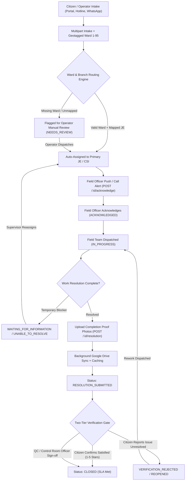
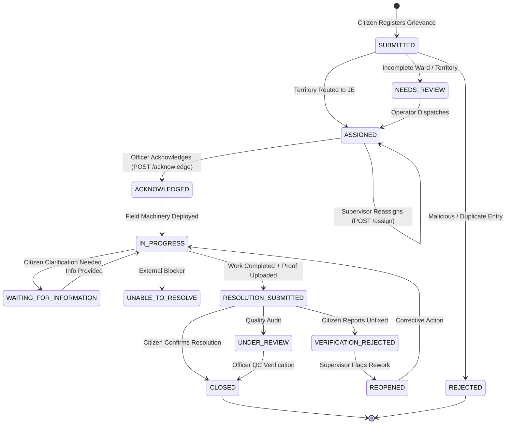
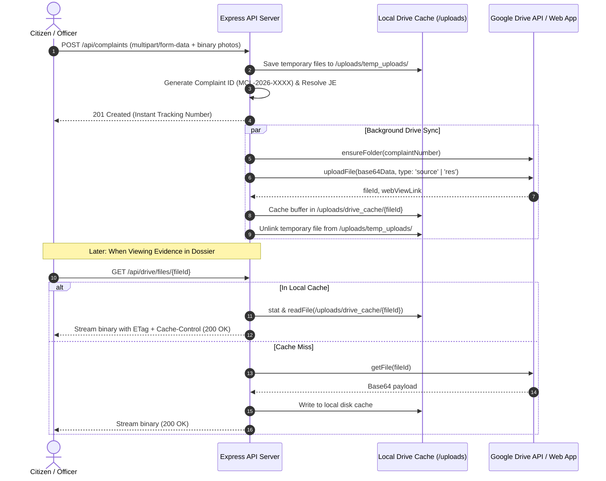

# MCL ICCC Smart Municipal Complaint Management System

**Organization:** Municipal Corporation Ludhiana (MCL)  
**System:** Integrated Command & Control Centre (ICCC)  
**Specification:** [`Mplan.md`](./Mplan.md)  
**Workflow Architecture PDF:** [`workflow.pdf`](./workflow.pdf)  
**Repository:** [suchitnagarnigam-star/ICCC](https://github.com/suchitnagarnigam-star/ICCC.git)

---

## 1. System Overview

The **MCL ICCC Complaint Management System** is an enterprise municipal governance platform engineered for the Municipal Corporation of Ludhiana. It orchestrates the full civic issue resolution lifecycle across all **95 wards** and **4 zones (A, B, C, D)**, routing citizen grievances across 4 municipal departments:
1. **O&M** (Operation & Maintenance — Water supply, sewerage, contaminated water, pipeline bursts)
2. **B&R** (Buildings & Roads — Potholes, road gullies, road patchwork)
3. **Health** (Sanitation, Garbage Vulnerable Points [GVP], tree falls)
4. **Light** (Street lighting, dark stretches, electrical failures)

The system enforces a **strict 48-working-hour SLA**, territorial auto-dispatch to designated Junior Engineers (JEs) and Chief Sanitary Inspectors (CSIs), background Google Drive media synchronization, and **two-tier resolution verification** (preventing premature ticket closure).

---

## 2. Core Architecture & Workflows

### 2.1 End-to-End Civic Grievance Lifecycle



---

### 2.2 Finite State Machine (13 Canonical States)



---

### 2.3 Google Drive Storage & Secure Proxy Pipeline



---

## 3. Department & Roster Mapping (95 Wards)

The municipal roster is loaded from `MCL Control Room ICCC.xlsx` (`MasterAll`) and managed by [`server/src/services/officerMappingService.ts`](file:///mnt/Data/1YUVRAJ/program/MCL/ICCC/server/src/services/officerMappingService.ts):

| Ward Range | Zone | Zone Commissioner | Primary Branches | Officer Hierarchy |
| :--- | :---: | :--- | :--- | :--- |
| **Wards 1 – 24** | **Zone A** | Sh. Amanpreet Singh, PCS | O&M, B&R, Health, Light | JE &rarr; SDO &rarr; XEN &rarr; SE &rarr; ZC &rarr; JC |
| **Wards 25 – 48** | **Zone B** | Sh. Niraj Jain, AC | O&M, B&R, Health, Light | JE &rarr; SDO &rarr; XEN &rarr; SE &rarr; ZC &rarr; JC |
| **Wards 49 – 72** | **Zone C** | Sh. Gurpal, AC | O&M, B&R, Health, Light | JE &rarr; SDO &rarr; XEN &rarr; SE &rarr; ZC &rarr; JC |
| **Wards 73 – 95** | **Zone D** | Sh. Jasdev Sekhon, AC | O&M, B&R, Health, Light | JE &rarr; SDO &rarr; XEN &rarr; SE &rarr; ZC &rarr; JC |

### 15 Official Complaint Categories
1. **Blocked Road Gully** (`O&M`)
2. **Open Manhole** (`O&M`)
3. **Water Logging** (`O&M`)
4. **Tree Fall** (`Health`)
5. **Contamination** (`O&M`)
6. **Potholes** (`B&R`)
7. **New Road Construction** (`B&R`)
8. **Garbage Vulnerable Points (GVP)** (`Health`)
9. **New Pipeline Water/Sewer** (`O&M`)
10. **Old Pipeline Burst** (`O&M`)
11. **Leakage Pipeline** (`O&M`)
12. **Sewerage/Road Jalis Overchock** (`O&M`)
13. **Sewerage/Road Jalis Desilting** (`O&M`)
14. **Street Light Issues** (`Light`)
15. **New Road Gully** (`B&R`)

---

## 4. REST API Specification

### Grievances (`/api/complaints`)

| Method | Endpoint | Description |
| :--- | :--- | :--- |
| `GET` | `/api/complaints` | Filter complaints by `status`, `branch`, `zone`, `wardNumber`, `search` |
| `GET` | `/api/complaints/:id` | Full complaint dossier with attachments, assigned officers, and SLA timer |
| `POST` | `/api/complaints` | Multipart complaint registration with auto-routing & background Drive sync |
| `GET` | `/api/complaints/:id/timeline` | Immutable chronological audit events |
| `POST` | `/api/complaints/:id/acknowledge` | Field officer acknowledgment (locks initial response clock) |
| `POST` | `/api/complaints/:id/assign` | Supervisor reassignment with mandatory audit reason |
| `POST` | `/api/complaints/:id/status` | Advance status (`IN_PROGRESS`, `WAITING_FOR_INFORMATION`, etc.) |
| `POST` | `/api/complaints/:id/resolution` | Field officer submits resolution notes and completion photos |
| `POST` | `/api/complaints/:id/verify-close` | Citizen / Supervisor verification and 5-star rating |

### Reference & Media

| Method | Endpoint | Description |
| :--- | :--- | :--- |
| `GET` | `/api/reference/categories` | Returns 15 complaint categories with branch mapping |
| `GET` | `/api/reference/zones` | Returns 4 zones with commissioner details |
| `GET` | `/api/reference/wards` | Returns 95 wards with administrative hierarchy |
| `GET` | `/api/reference/wards/:ward` | Detailed hierarchy and officer contacts for a specific ward |
| `GET` | `/api/drive/files/:fileId` | Secure proxy streaming of Drive files with local disk cache |

---

## 5. Frontend UI Structure

- **[`HomePage.tsx`](file:///mnt/Data/1YUVRAJ/program/MCL/ICCC/Frontend/src/pages/HomePage.tsx):** Municipal portal landing with branch metrics, hotline shortcuts, and SLA guarantees.
- **[`RegisterComplaintPage.tsx`](file:///mnt/Data/1YUVRAJ/program/MCL/ICCC/Frontend/src/pages/RegisterComplaintPage.tsx):** Drag-and-drop photo evidence uploader (max 5 files, 15MB each), automatic ward-to-zone derivation, instant category-branch indicator, and 5-second auto-redirect countdown.
- **[`TrackComplaintsPage.tsx`](file:///mnt/Data/1YUVRAJ/program/MCL/ICCC/Frontend/src/pages/TrackComplaintsPage.tsx):** Search by Complaint #, Complainant, Ward, or Officer; branch and status filter chips; SLA countdown pills.
- **[`ComplaintDetailPage.tsx`](file:///mnt/Data/1YUVRAJ/program/MCL/ICCC/Frontend/src/pages/ComplaintDetailPage.tsx):**
  - **Header:** Tracking ID with 1-click copy, dynamic 48h SLA badge with breach alert, status badge, branch pill.
  - **5-Stage Stepper:** Dynamic progress indicator showing active stage.
  - **4 Tabs:**
    - *Overview:* Citizen details, address with landmark, and **Assigned JE Profile Card** (click-to-call, WhatsApp, designation, supervisory SDO/XEN).
    - *Audit Trail:* Chronological timeline of all system and officer actions.
    - *Evidence Gallery:* Citizen intake photos and field resolution proof.
    - *Work Console:* Acknowledge assignment, update status, submit resolution, or reassign officer.
- **[`ImageViewerModal.tsx`](file:///mnt/Data/1YUVRAJ/program/MCL/ICCC/Frontend/src/components/ImageViewerModal.tsx):** Full-screen lightbox with zoom in/out, keyboard shortcuts (`+`, `-`, `0`, `Esc`), and file size tags.

---

## 6. Development & Deployment

### Quick Start (Full Stack)

Run both the Express backend and React frontend concurrently:

```bash
npm run dev:full
```

### Individual Services

```bash
# Backend Server (Port 5000)
cd server
npm install
npm run dev

# Frontend Client (Port 5173)
cd Frontend
npm install
npm run dev
```

### Production Verification

```bash
# Verify Server Build
npm --prefix server run build

# Verify Frontend Build
npm --prefix Frontend run build
```
